<!-- CUSTOM ANIMATED BANNER CARD -->

 

<!-- ANIMATED TYPING SUBHEADER -->

<!-- NAVIGATION & CONTACT SVG BADGES -->

  
  
  

<!-- ANIMATED SVG DIVIDER -->

### Overview

I am a Computer Science student at Can Tho University of Technology (CTUET) with a focus on algorithmic problem solving and applied machine learning. When developing systems, I evaluate multiple approaches to find solutions that balance computational efficiency with practical deployment. My current work centers on computer vision, Vietnamese natural language processing, and client-side model inference.

 

### Technical Stack

<table>
  <tr>
    <td align="center" width="33%">
      <b>LANGUAGES</b>  
      
    </td>
    <td align="center" width="34%">
      <b>AI &amp; MACHINE LEARNING</b>  
        
      
      
      
    </td>
    <td align="center" width="33%">
      <b>ENVIRONMENT &amp; TOOLS</b>  
      
    </td>
  </tr>
</table>

### Selected Projects

<table width="100%">
  <tr>
    <td width="33%" valign="top">
      
      <h4>Browser-Based Document Recognition</h4>
      
Client-side Vietnamese document classification utilizing ROI localization and ONNX Runtime Web inference.

    </td>
    <td width="33%" valign="top">
      
      <h4>Vietnamese Sentiment &amp; Topic Analysis</h4>
      
Multi-class sentiment polarity and topic classification built on fine-tuned PhoBERT architectures.

    </td>
    <td width="33%" valign="top">
      
      <h4>Campus Gate Vehicle Counting</h4>
      
Real-time vehicle detection, multi-object tracking, and traffic flow analysis using YOLO models.

    </td>
  </tr>
</table>

### Analytics & Activity

  

  
  &nbsp;&nbsp;
  

